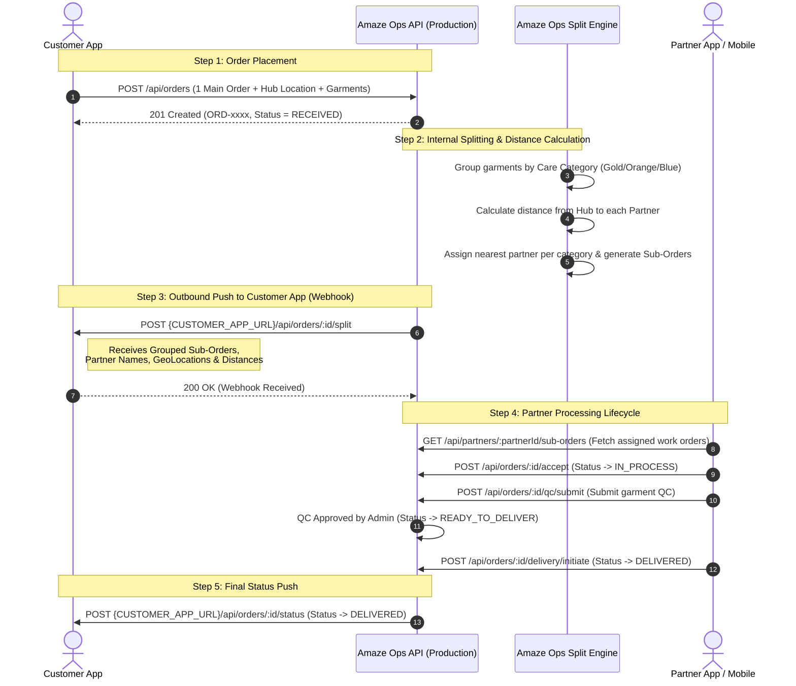

# Amaze Ops — Production API & Webhook Documentation
### Complete End-to-End Order Lifecycle & Split Order Integration Guide

> **Environment**: Production  
> **Amaze Ops API Base Gateway**: `https://amaze-ops.web.app/api`  
> **Direct Cloud Function URL**: `https://us-central1-amaze-ops.cloudfunctions.net/api`  
> **Authentication Header**: `x-api-key: amaze-fab-super-admin-key-2026`  
> **Content-Type**: `application/json`

---

## 1. System Flow & Architecture

Amaze Ops acts as the central operations engine. 
* The **Customer App** creates 1 main order with the Hub details and garments.
* **Amaze Ops** handles the intelligence: calculating distances from the Hub to each partner, splitting garments by Care Category, and assigning nearest partners.
* **Amaze Ops pushes outbound Webhooks** to the Customer App when orders are split and when lifecycle milestones change.



---

## 2. Inbound APIs (Customer App $\rightarrow$ Amaze Ops)

### Endpoint 1: Create Main Order
Called by the **Customer App** to submit a customer order with the Hub pickup/drop location.

* **Method**: `POST`
* **URL**: `https://amaze-ops.web.app/api/orders`
* **Headers**:
  ```http
  Content-Type: application/json
  x-api-key: amaze-fab-super-admin-key-2026
  ```

#### Request Payload:
```json
{
  "order_no": "ORD-1793308518124",
  "customer_name": "Rajiv Sharma",
  "customer_phone": "+91-9876543210",
  "city": "Bengaluru",
  "pincode": "560001",
  "hub": {
    "hubId": "HUB-BLR-01",
    "hubName": "Koramangala Central Hub",
    "geoLocation": {
      "latitude": 12.9352,
      "longitude": 77.6245
    }
  },
  "care_category": "Premium",
  "garments": [
    {
      "garment_id_code": "GAR-001",
      "qr_code": "QR-GAR-001",
      "garment_type": "Silk Saree",
      "category": "GOLD",
      "service_type": "Dry Clean"
    },
    {
      "garment_id_code": "GAR-002",
      "qr_code": "QR-GAR-002",
      "garment_type": "Cotton Shirt",
      "category": "ORANGE",
      "service_type": "Wash & Iron"
    },
    {
      "garment_id_code": "GAR-003",
      "qr_code": "QR-GAR-003",
      "garment_type": "Trousers",
      "category": "ORANGE",
      "service_type": "Wash & Iron"
    },
    {
      "garment_id_code": "GAR-004",
      "qr_code": "QR-GAR-004",
      "garment_type": "Bedsheet",
      "category": "BLUE",
      "service_type": "Wash & Iron"
    }
  ]
}
```

#### Response (`201 Created`):
```json
{
  "success": true,
  "orderId": "ORD-1793308518124",
  "message": "Order received and queued for partner assignment",
  "order": {
    "id": "ORD-1793308518124",
    "orderNumber": "ORD-1793308518124",
    "customer_name": "Rajiv Sharma",
    "status": "RECEIVED",
    "deliveryStatus": "PENDING",
    "createdAt": "2026-10-31T01:00:00.000Z"
  }
}
```

---

### Endpoint 2: Get Order Details & Grouped Sub-Orders
The Customer App can query this endpoint at any time to retrieve real-time status and the full grouped breakdown of sub-orders assigned to partners.

* **Method**: `GET`
* **URL**: `https://amaze-ops.web.app/api/orders/{orderNumber}`
* **Headers**:
  ```http
  x-api-key: amaze-fab-super-admin-key-2026
  ```

#### Response (`200 OK`):
```json
{
  "success": true,
  "orderId": "ORD-1793308518124",
  "mainOrderNumber": "ORD-1793308518124",
  "status": "ASSIGNED",
  "totalSubOrders": 3,
  "subOrders": [
    {
      "subOrderNumber": "ORD-1793308518124-GP02-1",
      "subOrderCode": "ORD-1793308518124-GP02-1",
      "partnerName": "Hostel Web",
      "partnerCode": "GP02",
      "partnerId": "PRT-002",
      "status": "ASSIGNED",
      "partnerGeoLocation": {
        "latitude": 12.9716,
        "longitude": 77.5946
      },
      "distance": "4.5 km",
      "distanceKm": 4.5,
      "careCategory": "ORANGE",
      "garmentCount": 2,
      "garmentIds": ["GAR-002", "GAR-003"]
    },
    {
      "subOrderNumber": "ORD-1793308518124-GP01-2",
      "subOrderCode": "ORD-1793308518124-GP01-2",
      "partnerName": "Ruby",
      "partnerCode": "GP01",
      "partnerId": "PRT-001",
      "status": "ASSIGNED",
      "partnerGeoLocation": {
        "latitude": 12.9279,
        "longitude": 77.6271
      },
      "distance": "9.21 km",
      "distanceKm": 9.21,
      "careCategory": "BLUE",
      "garmentCount": 1,
      "garmentIds": ["GAR-004"]
    },
    {
      "subOrderNumber": "ORD-1793308518124-GP01-3",
      "subOrderCode": "ORD-1793308518124-GP01-3",
      "partnerName": "Get Me Home",
      "partnerCode": "GP01",
      "partnerId": "PRT-003",
      "status": "ASSIGNED",
      "partnerGeoLocation": {
        "latitude": 12.9350,
        "longitude": 77.6100
      },
      "distance": "7.54 km",
      "distanceKm": 7.54,
      "careCategory": "GOLD",
      "garmentCount": 1,
      "garmentIds": ["GAR-001"]
    }
  ],
  "timeline": [
    { "stage": "RECEIVED", "completed": true, "current": false, "timestamp": "2026-10-31T01:00:00.000Z" },
    { "stage": "ASSIGNED", "completed": true, "current": true, "timestamp": "2026-10-31T01:05:00.000Z" },
    { "stage": "IN_PROCESS", "completed": false, "current": false, "timestamp": null },
    { "stage": "QC_PENDING", "completed": false, "current": false, "timestamp": null },
    { "stage": "COMPLETED", "completed": false, "current": false, "timestamp": null },
    { "stage": "DELIVERED", "completed": false, "current": false, "timestamp": null }
  ]
}
```

---

## 3. Outbound Webhooks (Amaze Ops $\rightarrow$ Customer App)

Once Amaze Ops splits the order based on nearest partner distance, it automatically pushes the split details to the Customer App server.

### Webhook 1: Grouped Split Order Notification
* **Sender**: Amaze Ops
* **Receiver**: Customer App Webhook (`POST {CUSTOMER_APP_URL}/api/orders/{orderNumber}/split`)
* **Headers Sent**:
  ```http
  Content-Type: application/json
  x-api-key: amaze-fab-super-admin-key-2026
  ```

#### Webhook Payload Received by Customer App:
```json
{
  "mainOrderNumber": "ORD-1793308518124",
  "status": "ASSIGNED",
  "totalSubOrders": 3,
  "timestamp": "2026-10-31T01:05:00.000Z",
  "subOrders": [
    {
      "subOrderNumber": "ORD-1793308518124-GP02-1",
      "partnerName": "Hostel Web",
      "partnerGeoLocation": {
        "latitude": 12.9716,
        "longitude": 77.5946
      },
      "distance": "4.5 km",
      "distanceKm": 4.5,
      "status": "ASSIGNED",
      "careCategory": "ORANGE",
      "garmentCount": 2,
      "garmentIds": ["GAR-002", "GAR-003"]
    },
    {
      "subOrderNumber": "ORD-1793308518124-GP01-2",
      "partnerName": "Ruby",
      "partnerGeoLocation": {
        "latitude": 12.9279,
        "longitude": 77.6271
      },
      "distance": "9.21 km",
      "distanceKm": 9.21,
      "status": "ASSIGNED",
      "careCategory": "BLUE",
      "garmentCount": 1,
      "garmentIds": ["GAR-004"]
    },
    {
      "subOrderNumber": "ORD-1793308518124-GP01-3",
      "partnerName": "Get Me Home",
      "partnerGeoLocation": {
        "latitude": 12.9350,
        "longitude": 77.6100
      },
      "distance": "7.54 km",
      "distanceKm": 7.54,
      "status": "ASSIGNED",
      "careCategory": "GOLD",
      "garmentCount": 1,
      "garmentIds": ["GAR-001"]
    }
  ]
}
```

#### Customer App Expected Response:
```json
{
  "success": true
}
```

---

### Webhook 2: Order Lifecycle Status Update (Sub-Order-Wise Breakdown)
Whenever any partner updates a sub-order's lifecycle stage (e.g. `IN_PROCESS`, `QC_PENDING`, `READY_TO_DELIVER`, `DELIVERED`), Amaze Ops automatically derives the overall order status and pushes this sub-order-wise breakdown directly to the Customer App server.

* **Sender**: Amaze Ops
* **Receiver**: Customer App Webhook (`POST {CUSTOMER_APP_URL}/api/orders/{mainOrderNumber}/status`)
* **Headers**: `Content-Type: application/json`, `x-api-key: amaze-fab-super-admin-key-2026`

#### Webhook Payload Received by Customer App:
```json
{
  "mainOrderNumber": "ORD-1793308518124",
  "overallStatus": "IN_PROCESS",
  "updatedSubOrder": {
    "subOrderNumber": "ORD-1793308518124-GP01-1",
    "status": "QC_PENDING",
    "partnerCode": "GP01",
    "partnerName": "Get Me Home",
    "careCategory": "Signature",
    "garmentCount": 4,
    "updatedAt": "2026-10-31T03:30:00.000Z"
  },
  "totalSubOrders": 3,
  "subOrders": [
    {
      "subOrderNumber": "ORD-1793308518124-GP01-1",
      "subOrderCode": "ORD-1793308518124-GP01-1",
      "partnerName": "Get Me Home",
      "partnerCode": "GP01",
      "partnerId": "PRT-001",
      "status": "QC_PENDING",
      "careCategory": "Signature",
      "distance": "10.12 km",
      "distanceKm": 10.12,
      "garmentCount": 4,
      "garmentIds": ["GAR-101", "GAR-102", "GAR-103", "GAR-104"],
      "updatedAt": "2026-10-31T03:30:00.000Z"
    },
    {
      "subOrderNumber": "ORD-1793308518124-BP01-3",
      "subOrderCode": "ORD-1793308518124-BP01-3",
      "partnerName": "Ruby",
      "partnerCode": "BP01",
      "partnerId": "PRT-003",
      "status": "ASSIGNED",
      "careCategory": "Premium",
      "distance": "3.44 km",
      "distanceKm": 3.44,
      "garmentCount": 2,
      "garmentIds": ["GAR-105", "GAR-106"],
      "updatedAt": "2026-10-31T02:30:00.000Z"
    },
    {
      "subOrderNumber": "ORD-1793308518124-GP02-2",
      "subOrderCode": "ORD-1793308518124-GP02-2",
      "partnerName": "Hostel Web",
      "partnerCode": "GP02",
      "partnerId": "PRT-002",
      "status": "ASSIGNED",
      "careCategory": "Pristine",
      "distance": "4.27 km",
      "distanceKm": 4.27,
      "garmentCount": 2,
      "garmentIds": ["GAR-107", "GAR-108"],
      "updatedAt": "2026-10-31T02:30:00.000Z"
    }
  ],
  "timestamp": "2026-10-31T03:30:00.000Z"
}
```

---

## 4. Partner App & Lifecycle APIs

These endpoints are used by the **Partner Mobile App** or partner web portal to process allocated work orders. They can accept either a `subOrderNumber` (e.g. `ORD-xxx-GP01-1`) or a `mainOrderNumber`.

### 4.1 Fetch Partner Work Orders
Retrieve only the sub-orders allocated to a specific partner:
* **Method**: `GET`
* **URL**: `https://amaze-ops.web.app/api/partners/{partnerId}/sub-orders`
* **Response**:
```json
{
  "success": true,
  "partnerId": "PRT-002",
  "count": 1,
  "subOrders": [
    {
      "subOrderNumber": "ORD-1793308518124-GP02-1",
      "mainOrderNumber": "ORD-1793308518124",
      "partnerName": "Hostel Web",
      "status": "ASSIGNED",
      "careCategory": "Pristine",
      "distance": "4.27 km",
      "garmentCount": 2,
      "garmentIds": ["GAR-002", "GAR-003"]
    }
  ]
}
```

### 4.2 Partner Accepts Sub-Order
Moves sub-order status to `IN_PROCESS`:
* **Method**: `POST`
* **URL**: `https://amaze-ops.web.app/api/orders/{subOrderNumber}/accept` (or `/api/sub-orders/{subOrderNumber}/accept`)
* **Response**:
```json
{
  "success": true,
  "orderId": "ORD-1793308518124",
  "mainOrderNumber": "ORD-1793308518124",
  "subOrderId": "ORD-1793308518124-GP01-1",
  "status": "IN_PROCESS",
  "overallStatus": "IN_PROCESS",
  "updatedSubOrder": {
    "subOrderNumber": "ORD-1793308518124-GP01-1",
    "status": "IN_PROCESS"
  },
  "totalSubOrders": 3,
  "subOrders": [ ... ],
  "customerAppNotified": true,
  "message": "Order accepted by partner"
}
```

### 4.3 Partner Submits QC
Submits inspection results, garment quality scores, and photos:
* **Method**: `POST`
* **URL**: `https://amaze-ops.web.app/api/orders/{subOrderNumber}/qc/submit` (or `/api/sub-orders/{subOrderNumber}/qc/submit`)
* **Request**:
```json
{
  "subOrderNumber": "ORD-1793308518124-GP01-1",
  "garments": [
    {
      "garmentId": "GAR-1793393524578-661",
      "brand": "Raymond",
      "comments": "Slight stain pre-treated",
      "photos": {
        "front": "https://amaze-plant.s3.ap-south-1.amazonaws.com/qc/...front.jpg",
        "back": "https://amaze-plant.s3.ap-south-1.amazonaws.com/qc/...back.jpg",
        "other": "https://amaze-plant.s3.ap-south-1.amazonaws.com/qc/...tag.jpg"
      },
      "garmentQuality": 4
    }
  ]
}
```
* **Response**:
```json
{
  "success": true,
  "mainOrderNumber": "ORD-1793308518124",
  "subOrderId": "ORD-1793308518124-GP01-1",
  "status": "QC_PENDING",
  "overallStatus": "QC_PENDING",
  "updatedSubOrder": {
    "subOrderNumber": "ORD-1793308518124-GP01-1",
    "status": "QC_PENDING"
  },
  "totalSubOrders": 3,
  "subOrders": [ ... ],
  "customerAppNotified": true,
  "message": "QC submitted"
}
```

### 4.4 Admin Approves QC
* **Method**: `POST`
* **URL**: `https://amaze-ops.web.app/api/orders/{subOrderNumber}/qc/approve`
* **Response**:
```json
{
  "success": true,
  "mainOrderNumber": "ORD-1793308518124",
  "subOrderId": "ORD-1793308518124-GP01-1",
  "status": "READY_TO_DELIVER",
  "overallStatus": "READY_TO_DELIVER",
  "updatedSubOrder": {
    "subOrderNumber": "ORD-1793308518124-GP01-1",
    "status": "READY_TO_DELIVER"
  },
  "totalSubOrders": 3,
  "subOrders": [ ... ],
  "customerAppNotified": true,
  "message": "QC approved"
}
```

### 4.5 Partner Initiates Delivery
Marks the sub-order as delivered:
* **Method**: `POST`
* **URL**: `https://amaze-ops.web.app/api/orders/{subOrderNumber}/delivery/initiate`
* **Response**:
```json
{
  "success": true,
  "mainOrderNumber": "ORD-1793308518124",
  "subOrderId": "ORD-1793308518124-GP01-1",
  "status": "DELIVERED",
  "overallStatus": "DELIVERED",
  "updatedSubOrder": {
    "subOrderNumber": "ORD-1793308518124-GP01-1",
    "status": "DELIVERED"
  },
  "totalSubOrders": 3,
  "subOrders": [ ... ],
  "customerAppNotified": true,
  "message": "Delivery initiated and completed"
}
```

### 4.6 Generic Status Update (Sub-Order or Main Order)
* **Method**: `PATCH` or `PUT`
* **URL**: `https://amaze-ops.web.app/api/orders/{id}/status` or `https://amaze-ops.web.app/api/sub-orders/{subOrderId}/status`
* **Request**:
```json
{
  "status": "IN_PROCESS"
}
```

---

## 5. cURL Integration Examples

### 1. Customer App Placing an Order:
```bash
curl -X POST "https://amaze-ops.web.app/api/orders" \
  -H "Content-Type: application/json" \
  -H "x-api-key: amaze-fab-super-admin-key-2026" \
  -d '{
    "order_no": "ORD-1793308518124",
    "customer_name": "Rajiv Sharma",
    "customer_phone": "+91-9876543210",
    "city": "Bengaluru",
    "pincode": "560001",
    "hub": {
      "hubId": "HUB-BLR-01",
      "hubName": "Koramangala Central Hub",
      "geoLocation": { "latitude": 12.9352, "longitude": 77.6245 }
    },
    "care_category": "Premium",
    "garments": [
      { "garment_id_code": "GAR-001", "category": "GOLD", "garment_type": "Silk Saree" },
      { "garment_id_code": "GAR-002", "category": "ORANGE", "garment_type": "Shirt" }
    ]
  }'
```

### 2. Customer App Querying Order & Grouped Sub-Orders:
```bash
curl -X GET "https://amaze-ops.web.app/api/orders/ORD-1793308518124" \
  -H "x-api-key: amaze-fab-super-admin-key-2026"
```
