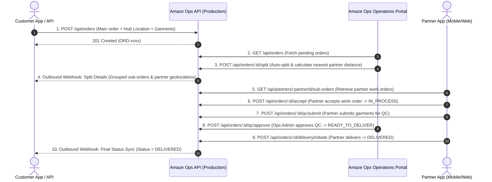

# Amaze Ops — Production API Documentation (End-to-End Order Lifecycle)

> **Environment**: Production  
> **Production API Base Gateway**: `https://amaze-ops.web.app/api`  
> **Direct Cloud Function URL**: `https://us-central1-amaze-ops.cloudfunctions.net/api`  
> **Authentication Header**: `x-api-key: amaze-fab-super-admin-key-2026`  
> **Content-Type**: `application/json`

---

## 1. Overview & Architecture

Amaze Ops orchestrates garment care processing from the moment a customer places an order until final delivery.



---

## 2. Authentication & Headers

Every request to the Amaze Ops Production API requires the `x-api-key` header:

```http
Content-Type: application/json
x-api-key: amaze-fab-super-admin-key-2026
```

If the key is missing or invalid, the API returns:
```json
{
  "error": "Unauthorized: Invalid or missing x-api-key header"
}
```

---

## 3. Order Lifecycle Endpoints

### Step 1: Ingest Main Order (`POST /api/orders`)
Called by the **Customer App** to push a newly placed order into the operations system.

* **Method**: `POST`
* **Production Endpoint**: `https://amaze-ops.web.app/api/orders`
* **Request Body**:
```json
{
  "order_no": "ORD-1793308518124",
  "customer_name": "Rajiv Sharma",
  "customer_phone": "+91-9876543210",
  "city": "Bengaluru",
  "pincode": "560001",
  "hub": {
    "hubId": "HUB-BLR-01",
    "hubName": "Koramangala Central Hub",
    "geoLocation": {
      "latitude": 12.9352,
      "longitude": 77.6245
    }
  },
  "care_category": "Premium",
  "garments": [
    {
      "garment_id_code": "GAR-1793308518124-001",
      "qr_code": "QR-GAR-001",
      "garment_type": "Silk Saree",
      "category": "GOLD",
      "service_type": "Dry Clean"
    },
    {
      "garment_id_code": "GAR-1793308518124-002",
      "qr_code": "QR-GAR-002",
      "garment_type": "Cotton Shirt",
      "category": "ORANGE",
      "service_type": "Wash & Iron"
    },
    {
      "garment_id_code": "GAR-1793308518124-003",
      "qr_code": "QR-GAR-003",
      "garment_type": "Bedsheet",
      "category": "BLUE",
      "service_type": "Wash & Iron"
    }
  ]
}
```

* **Response (`201 Created`)**:
```json
{
  "success": true,
  "orderId": "ORD-1793308518124",
  "message": "Order received and queued for partner assignment",
  "order": {
    "id": "ORD-1793308518124",
    "orderNumber": "ORD-1793308518124",
    "customer_name": "Rajiv Sharma",
    "status": "RECEIVED",
    "deliveryStatus": "PENDING",
    "createdAt": "2026-10-31T01:00:00.000Z"
  }
}
```

---

### Step 2: Order Retrieval & Tracking (`GET /api/orders/:id`)
Retrieve real-time tracking, sub-order breakdown, and lifecycle milestones.

* **Method**: `GET`
* **Production Endpoint**: `https://amaze-ops.web.app/api/orders/ORD-1793308518124`
* **Response (`200 OK`)**:
```json
{
  "success": true,
  "orderId": "ORD-1793308518124",
  "status": "ASSIGNED",
  "order": {
    "orderNumber": "ORD-1793308518124",
    "customer_name": "Rajiv Sharma",
    "status": "ASSIGNED",
    "subOrders": [
      {
        "subOrderNumber": "ORD-1793308518124-GP02-1",
        "partnerName": "Hostel Web",
        "status": "ASSIGNED",
        "distance": "4.5 km"
      }
    ]
  },
  "timeline": [
    { "stage": "RECEIVED", "completed": true, "current": false, "timestamp": "2026-10-31T01:00:00.000Z" },
    { "stage": "ASSIGNED", "completed": true, "current": true, "timestamp": "2026-10-31T01:05:00.000Z" },
    { "stage": "IN_PROCESS", "completed": false, "current": false, "timestamp": null },
    { "stage": "QC_PENDING", "completed": false, "current": false, "timestamp": null },
    { "stage": "COMPLETED", "completed": false, "current": false, "timestamp": null },
    { "stage": "DELIVERED", "completed": false, "current": false, "timestamp": null }
  ]
}
```

---

### Step 3: Split Order & Partner Allocation (`POST /api/orders/:id/split`)
Amaze Ops splits the main order into sub-orders based on **Care Category** and assigns the **nearest capable partner** by calculating distance from the Hub.

* **Method**: `POST`
* **Production Endpoint**: `https://amaze-ops.web.app/api/orders/ORD-1793308518124/split`
* **Request Body (Grouped Format)**:
```json
{
  "mainOrderNumber": "ORD-1793308518124",
  "status": "ASSIGNED",
  "subOrders": [
    {
      "subOrderNumber": "ORD-1793308518124-GP02-1",
      "partnerName": "Hostel Web",
      "partnerCode": "GP02",
      "partnerId": "PRT-002",
      "partnerGeoLocation": {
        "latitude": 12.9716,
        "longitude": 77.5946
      },
      "distance": "4.5 km",
      "distanceKm": 4.5,
      "status": "ASSIGNED",
      "careCategory": "ORANGE",
      "garmentCount": 3,
      "garmentIds": [
        "GAR-1793308518124-002",
        "GAR-1793308518124-003",
        "GAR-1793308518124-004"
      ]
    },
    {
      "subOrderNumber": "ORD-1793308518124-GP01-2",
      "partnerName": "Ruby",
      "partnerCode": "GP01",
      "partnerId": "PRT-001",
      "partnerGeoLocation": {
        "latitude": 12.9279,
        "longitude": 77.6271
      },
      "distance": "9.21 km",
      "distanceKm": 9.21,
      "status": "ASSIGNED",
      "careCategory": "BLUE",
      "garmentCount": 3,
      "garmentIds": [
        "GAR-1793308518124-005",
        "GAR-1793308518124-006",
        "GAR-1793308518124-007"
      ]
    },
    {
      "subOrderNumber": "ORD-1793308518124-GP01-3",
      "partnerName": "Get Me Home",
      "partnerCode": "GP01",
      "partnerId": "PRT-003",
      "partnerGeoLocation": {
        "latitude": 12.9350,
        "longitude": 77.6100
      },
      "distance": "7.54 km",
      "distanceKm": 7.54,
      "status": "ASSIGNED",
      "careCategory": "GOLD",
      "garmentCount": 2,
      "garmentIds": [
        "GAR-1793308518124-001",
        "GAR-1793308518124-008"
      ]
    }
  ]
}
```

* **Response (`200 OK`)**:
```json
{
  "success": true,
  "mainOrderNumber": "ORD-1793308518124",
  "status": "ASSIGNED",
  "totalSubOrders": 3,
  "customerAppNotified": true,
  "subOrders": [
    {
      "subOrderNumber": "ORD-1793308518124-GP02-1",
      "partnerName": "Hostel Web",
      "partnerGeoLocation": {
        "latitude": 12.9716,
        "longitude": 77.5946
      },
      "distance": "4.5 km",
      "distanceKm": 4.5,
      "status": "ASSIGNED",
      "careCategory": "ORANGE",
      "garmentCount": 3
    },
    {
      "subOrderNumber": "ORD-1793308518124-GP01-2",
      "partnerName": "Ruby",
      "partnerGeoLocation": {
        "latitude": 12.9279,
        "longitude": 77.6271
      },
      "distance": "9.21 km",
      "distanceKm": 9.21,
      "status": "ASSIGNED",
      "careCategory": "BLUE",
      "garmentCount": 3
    },
    {
      "subOrderNumber": "ORD-1793308518124-GP01-3",
      "partnerName": "Get Me Home",
      "partnerGeoLocation": {
        "latitude": 12.9350,
        "longitude": 77.6100
      },
      "distance": "7.54 km",
      "distanceKm": 7.54,
      "status": "ASSIGNED",
      "careCategory": "GOLD",
      "garmentCount": 2
    }
  ]
}
```

---

### Step 4: Partner Work Order Fetching & Acceptance
The Partner Mobile/Web App fetches assigned sub-orders and updates status to `IN_PROCESS`.

#### 4.1 Fetch Partner's Sub-Orders (`GET /api/partners/:partnerId/sub-orders`)
* **Method**: `GET`
* **Production Endpoint**: `https://amaze-ops.web.app/api/partners/PRT-002/sub-orders`
* **Response (`200 OK`)**:
```json
{
  "success": true,
  "partnerId": "PRT-002",
  "count": 1,
  "subOrders": [
    {
      "subOrderNumber": "ORD-1793308518124-GP02-1",
      "mainOrderNumber": "ORD-1793308518124",
      "partnerName": "Hostel Web",
      "status": "ASSIGNED",
      "careCategory": "ORANGE",
      "distance": "4.5 km",
      "garmentCount": 3
    }
  ]
}
```

#### 4.2 Partner Accepts Order (`POST /api/orders/:id/accept`)
* **Method**: `POST`
* **Production Endpoint**: `https://amaze-ops.web.app/api/orders/ORD-1793308518124/accept`
* **Response (`200 OK`)**:
```json
{
  "success": true,
  "orderId": "ORD-1793308518124",
  "status": "IN_PROCESS",
  "message": "Order accepted by partner"
}
```

---

### Step 5: Garment Inspection & Quality Control (QC)

#### 5.1 Partner Submits QC (`POST /api/orders/:id/qc/submit`)
* **Method**: `POST`
* **Production Endpoint**: `https://amaze-ops.web.app/api/orders/ORD-1793308518124/qc/submit`
* **Request Body**:
```json
{
  "subOrderNumber": "ORD-1793308518124-GP02-1",
  "inspectedBy": "Operator-Rajesh",
  "garments": [
    {
      "garmentId": "GAR-1793308518124-002",
      "status": "VERIFIED",
      "defects": [],
      "notes": "No stains, condition good"
    }
  ]
}
```
* **Response (`200 OK`)**:
```json
{
  "success": true,
  "orderId": "ORD-1793308518124",
  "status": "QC_PENDING",
  "message": "QC submitted"
}
```

#### 5.2 Admin Approves QC (`POST /api/orders/:id/qc/approve`)
* **Method**: `POST`
* **Production Endpoint**: `https://amaze-ops.web.app/api/orders/ORD-1793308518124/qc/approve`
* **Response (`200 OK`)**:
```json
{
  "success": true,
  "orderId": "ORD-1793308518124",
  "status": "READY_TO_DELIVER",
  "message": "QC approved"
}
```

---

### Step 6: Dispatch & Final Delivery (`POST /api/orders/:id/delivery/initiate`)
* **Method**: `POST`
* **Production Endpoint**: `https://amaze-ops.web.app/api/orders/ORD-1793308518124/delivery/initiate`
* **Response (`200 OK`)**:
```json
{
  "success": true,
  "orderId": "ORD-1793308518124",
  "status": "DELIVERED",
  "message": "Delivery initiated and completed"
}
```

---

### Step 7: Update Status (`PATCH /api/orders/:id/status`)
Used to update main order status directly at any stage.

* **Method**: `PATCH`
* **Production Endpoint**: `https://amaze-ops.web.app/api/orders/ORD-1793308518124/status`
* **Request Body**:
```json
{
  "status": "DELIVERED"
}
```
* **Response (`200 OK`)**:
```json
{
  "success": true,
  "message": "Status updated to DELIVERED"
}
```

---

## 4. Outbound Webhook Reference (Customer App Callbacks)

When events happen in Amaze Ops, it automatically pushes webhooks to the Customer App endpoint:
`POST {CUSTOMER_APP_URL}/api/orders/{orderNumber}/split` with header `x-api-key: amaze-fab-super-admin-key-2026`.

### Grouped Split Order Webhook Payload:
```json
{
  "mainOrderNumber": "ORD-1793308518124",
  "status": "ASSIGNED",
  "totalSubOrders": 3,
  "timestamp": "2026-10-31T01:10:00.000Z",
  "subOrders": [
    {
      "subOrderNumber": "ORD-1793308518124-GP02-1",
      "subOrderCode": "ORD-1793308518124-GP02-1",
      "partnerName": "Hostel Web",
      "partnerCode": "GP02",
      "partnerId": "PRT-002",
      "status": "ASSIGNED",
      "partnerGeoLocation": {
        "latitude": 12.9716,
        "longitude": 77.5946
      },
      "distance": "4.5 km",
      "distanceKm": 4.5,
      "careCategory": "ORANGE",
      "garmentCount": 3,
      "garmentIds": [
        "GAR-1793308518124-002",
        "GAR-1793308518124-003",
        "GAR-1793308518124-004"
      ]
    },
    {
      "subOrderNumber": "ORD-1793308518124-GP01-2",
      "subOrderCode": "ORD-1793308518124-GP01-2",
      "partnerName": "Ruby",
      "partnerCode": "GP01",
      "partnerId": "PRT-001",
      "status": "ASSIGNED",
      "partnerGeoLocation": {
        "latitude": 12.9279,
        "longitude": 77.6271
      },
      "distance": "9.21 km",
      "distanceKm": 9.21,
      "careCategory": "BLUE",
      "garmentCount": 3,
      "garmentIds": [
        "GAR-1793308518124-005",
        "GAR-1793308518124-006",
        "GAR-1793308518124-007"
      ]
    },
    {
      "subOrderNumber": "ORD-1793308518124-GP01-3",
      "subOrderCode": "ORD-1793308518124-GP01-3",
      "partnerName": "Get Me Home",
      "partnerCode": "GP01",
      "partnerId": "PRT-003",
      "status": "ASSIGNED",
      "partnerGeoLocation": {
        "latitude": 12.9350,
        "longitude": 77.6100
      },
      "distance": "7.54 km",
      "distanceKm": 7.54,
      "careCategory": "GOLD",
      "garmentCount": 2,
      "garmentIds": [
        "GAR-1793308518124-001",
        "GAR-1793308518124-008"
      ]
    }
  ]
}
```

---

## 5. Production cURL Examples

### Push New Order:
```bash
curl -X POST "https://amaze-ops.web.app/api/orders" \
  -H "Content-Type: application/json" \
  -H "x-api-key: amaze-fab-super-admin-key-2026" \
  -d '{
    "order_no": "ORD-1793308518124",
    "customer_name": "Rajiv Sharma",
    "customer_phone": "+91-9876543210",
    "city": "Bengaluru",
    "pincode": "560001",
    "care_category": "Premium",
    "garments": [
      { "garment_id_code": "GAR-001", "category": "GOLD", "garment_type": "Silk Saree" }
    ]
  }'
```

### Push Split Sub-Orders (Grouped):
```bash
curl -X POST "https://amaze-ops.web.app/api/orders/ORD-1793308518124/split" \
  -H "Content-Type: application/json" \
  -H "x-api-key: amaze-fab-super-admin-key-2026" \
  -d '{
    "mainOrderNumber": "ORD-1793308518124",
    "status": "ASSIGNED",
    "subOrders": [
      {
        "subOrderNumber": "ORD-1793308518124-GP02-1",
        "partnerName": "Hostel Web",
        "partnerGeoLocation": { "latitude": 12.9716, "longitude": 77.5946 },
        "distance": "4.5 km",
        "status": "ASSIGNED",
        "careCategory": "ORANGE",
        "garmentCount": 3
      }
    ]
  }'
```

### Track Order Status:
```bash
curl -X GET "https://amaze-ops.web.app/api/orders/ORD-1793308518124" \
  -H "x-api-key: amaze-fab-super-admin-key-2026"
```
